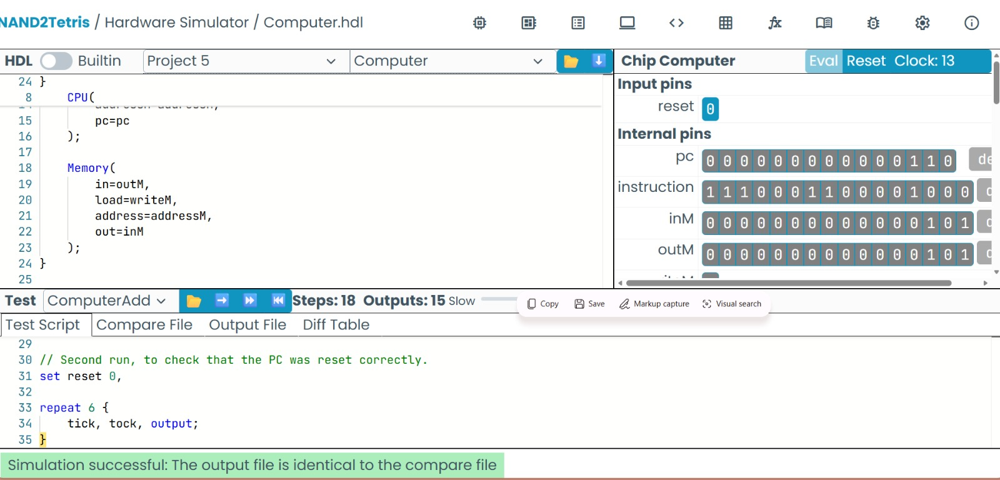
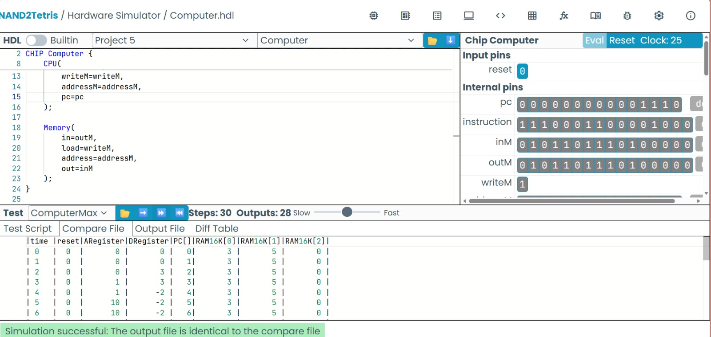
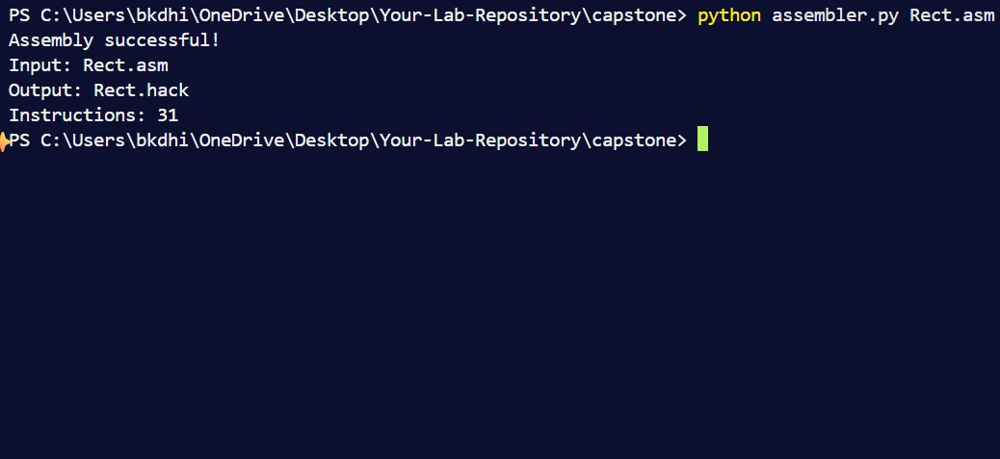
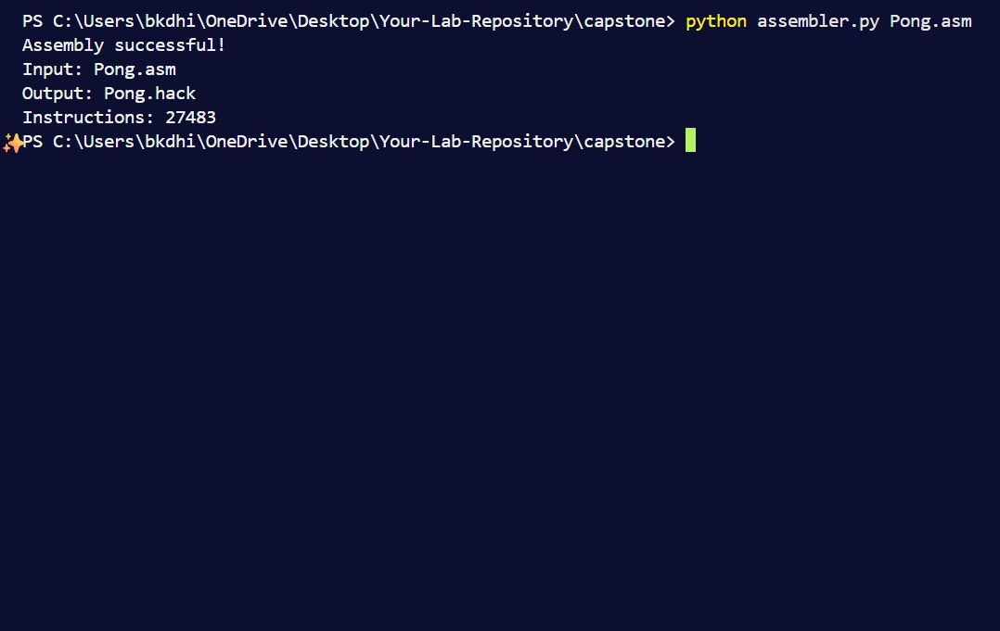
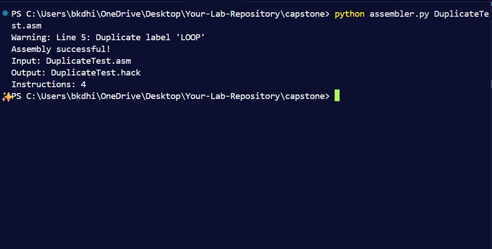
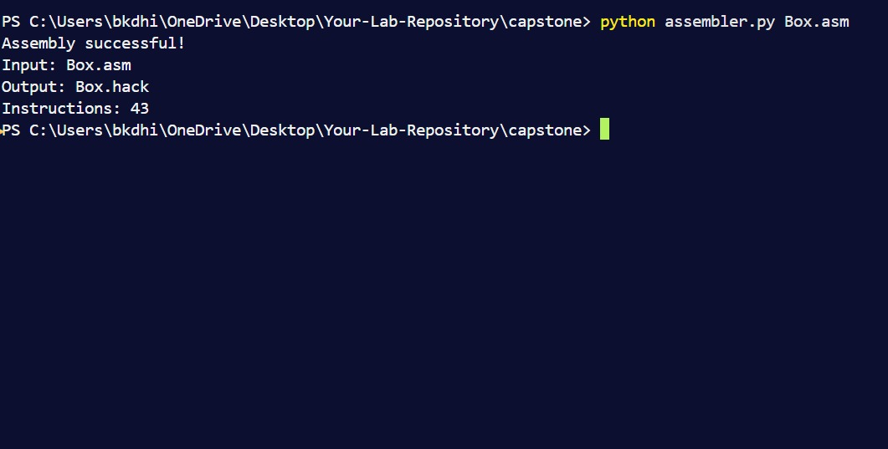
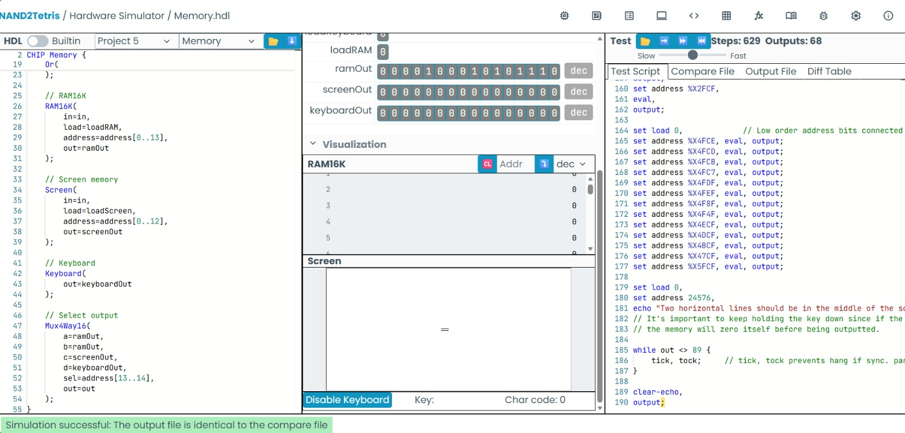

# Nand2Tetris Capstone Project

**Student:** Bhavya  
**Roll Number:** 2501350086  
**University:** K.R. Mangalam University

## Project Overview

This capstone project is based on the Nand2Tetris course. It focuses on building a Hack Computer using HDL and developing a two-pass Python Assembler that converts Hack Assembly programs (`.asm`) into machine code (`.hack`).

The project includes CPU, Memory, and Computer components, assembler testing with Add, Max, Rect, and Pong programs, and duplicate-label detection as an additional assembler feature.

The Box Drawing Program displays a black rectangle of **48 pixels width and 20 rows height**, starting at row **86**, while a keyboard key is pressed, and clears it when the key is released.

## Technologies Used

- HDL
- Hack Assembly
- Python
- Nand2Tetris Hardware Simulator
- CPU Emulator

## Project Structure

```text
Your-Lab-Repository/
├── README.md
└── capstone/
    ├── Add.asm
    ├── Add.hack
    ├── Box.asm
    ├── Box.hack
    ├── Computer.hdl
    ├── CPU.hdl
    ├── Memory.hdl
    ├── assembler.py
    ├── Max.asm
    ├── Max.hack
    ├── Rect.asm
    ├── Rect.hack
    ├── Pong.asm
    ├── Pong.hack
    ├── DuplicateTest.asm
    ├── DuplicateTest.hack
    


CPU.hdl


 ComputerAdd


 ComputerMax


 ComputerRect


 Max.hack


 python assembler.py Rect.asm


 python assembler.py Pong.asm


 python assembler.py DuplicateTest.asm


 Add.hack


 python assembler.py Box.asm


 Memory.hdl


## Assembler

Run the assembler from the `capstone` directory:

```bash
python assembler.py Add.asm
```

Use another `.asm` file name to assemble a different program. The generated machine-code file uses the `.hack` extension.

## Notes

- The `.asm` files contain Hack Assembly source programs.
- The `.hack` files contain the corresponding machine-code output.
- HDL files describe the Hack Computer hardware components.
- The `Proof/` folder contains the project screenshots supplied with this repository.

This project, developed by **Bhavya  (Roll No. 2501350086)** at **K.R. Mangalam University**, is based on the Nand2Tetris course and focuses on building a Hack Computer using HDL, developing a two-pass Python Assembler to convert Hack Assembly programs (`.asm`) into machine code (`.hack`), and implementing a Box Drawing Program. The project includes CPU, Memory, and Computer components, assembler testing with Add, Max, Rect, and Pong programs, and duplicate-label detection as the additional assembler feature. The Box Program displays a black rectangle of **48 pixels width and 20 rows height**, starting at row **86**, while a keyboard key is pressed and clears it when released. Technologies used include **HDL, Hack Assembly, Python, Nand2Tetris Hardware Simulator, and CPU Emulator**.

-> CPU 


-> Computer Add


-> Computer Max 


-> Computer Rect


-> Max.hack


-> Assembler.py Rect.asm


-> Assembler.py Pong.asm


-> Assembler.py DuplicateTest.asm


-> Add.hack


-> Assembler.py Box.asm


-> Memory 

